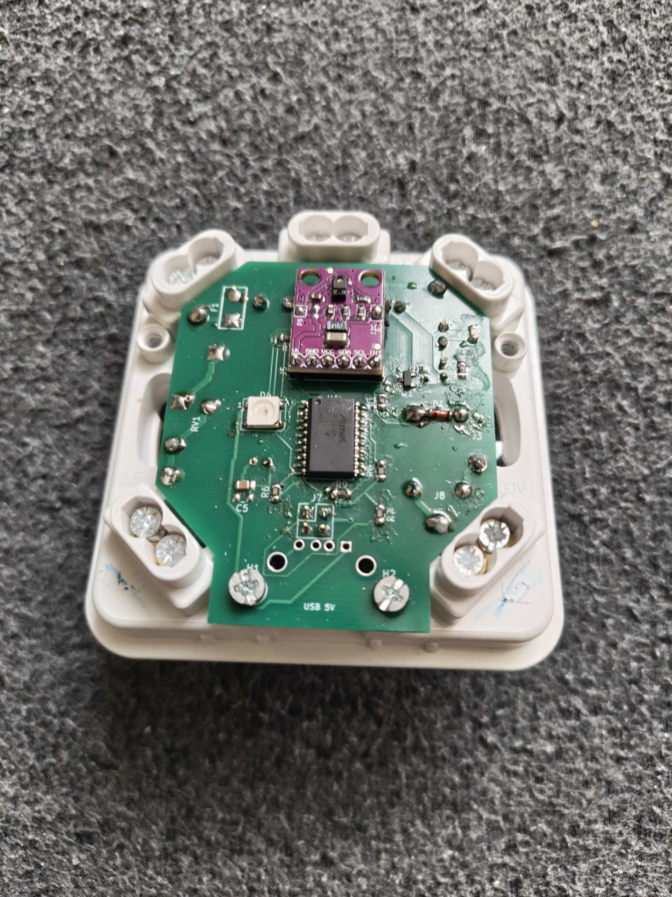
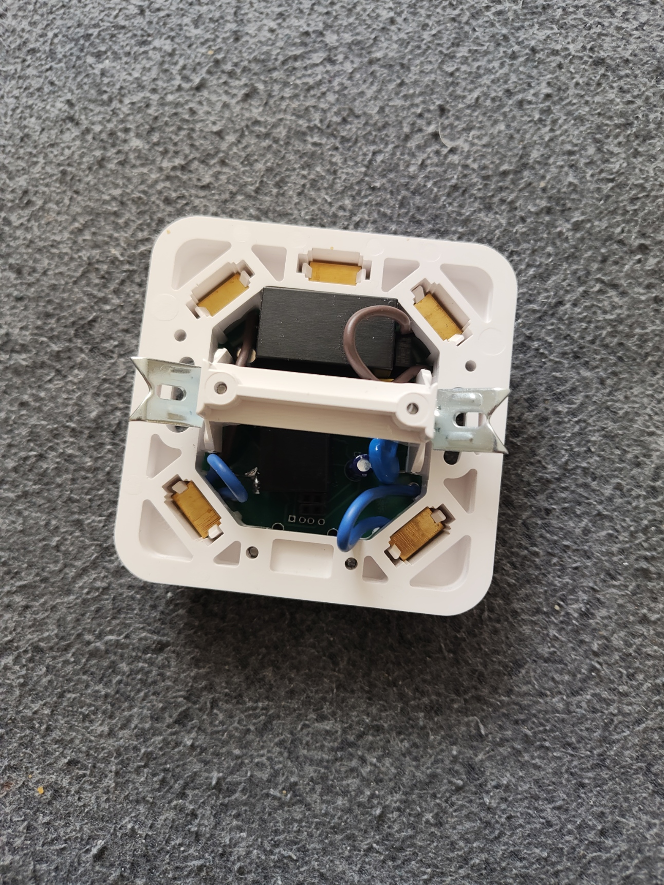
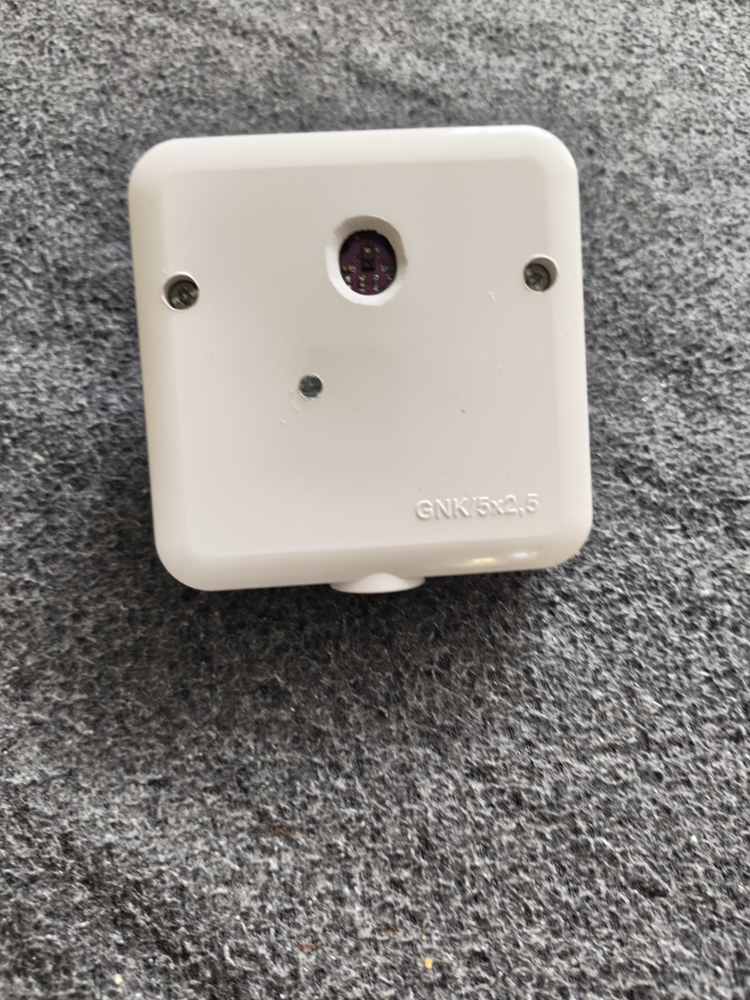

# No-Touch Door and Light Switch

A compact ATtiny3216 controller that switches one LED lamp by hand gesture or
when a sliding door moves in front of an APDS-9960 sensor. The repository
contains the KiCad design, parts list, PCB fabrication files, firmware, and the
documents needed to assemble and program the prototype.

## Prototype

*Controller PCB fitted in the enclosure with its cover removed.*

*Enclosure interior showing the power supply and wiring.*

*Front cover with separate sensor and status LED openings.*

## Build and program

1. Open `hardware/notuchswitch.kicad_pro` in KiCad 9 or later. PCB component
   placement is fixed; use the supplied Gerbers to order the board.
2. Assemble the board using [`hardware/BOM.csv`](hardware/BOM.csv) and the
   [hardware notes](hardware/README.md). Confirm the parts marked for footprint
   verification before ordering or soldering.
3. Open `software/notuchswitch_firmware/notuchswitch_firmware.ino` in Arduino
   IDE 2. Install megaTinyCore and select the ATtiny3216 settings described in
   [`software/README.md`](software/README.md).
4. Program through the on-board J7 SerialUPDI header using a 3.3 V USB-to-UART
   adapter. The classic USBasp programmer does not connect directly to J7; see
   [`software/SERIALUPDI.md`](software/SERIALUPDI.md).
5. Print the [cover drilling template](hardware/templates/cover_drill_template.pdf)
   at 100% and verify its 20 mm scale bar before drilling.

See the [user guide](docs/user-guide.md) for operation, menu settings, and
calibration.

## Safety and license

This is a mains-powered engineering prototype, not a certified product. Verify
the exact components, insulation distances, enclosure, wiring, temperature,
and applicable electrical safety requirements before connecting it to mains.

The project is released under the MIT License; see [`LICENSE`](LICENSE).
